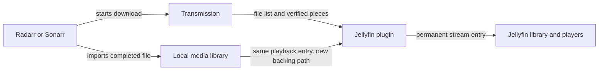

# Transmission Streaming for Jellyfin

A prototype Jellyfin plugin that makes arr-managed Transmission downloads playable before they finish. Playback stays inside Jellyfin, including each user's watched status and resume position. A finished download keeps the same Jellyfin entry.

Targets **Jellyfin 12.3**, **.NET 10**, and **Transmission 4.1.3**. This is a development prototype. Automated tests cover the reader, matching, paths, and HTTP ranges; live playback and a real arr completion handoff have not yet been validated.

## How it works



1. The plugin polls Transmission and matches video files to Radarr or Sonarr queue entries using the download's torrent hash. Standard episode filenames identify individual episodes within season packs.
2. It creates a permanent, small stream link and metadata sidecars in a dedicated projection folder. Jellyfin scans these as ordinary movies and episodes.
3. Pressing Play opens a stable URL served by the plugin. The reader serves downloaded, verified pieces and waits for missing bytes. It never fills a missing range with zeros or treats the current partial file size as the finished size.
4. By default, playback enables sequential downloading for that torrent and moves the sequential cursor toward missing playback pieces. Transmission remains the only torrent engine.
5. After arr imports the file, the plugin verifies the import history against the original torrent hash, source filename, byte size, and imported file identity. Playback then reads from the imported local file through the same stream link.

The projection's path and Jellyfin entry stay stable across completion. The completed native file is hidden from Jellyfin's resolver while the plugin manages its projection, preventing a second library item. If a scan catches the native item before reconciliation, the plugin merges its user state into the projection before removing that duplicate database entry. It does not delete the media file, and an active session on the native item is allowed to finish first.

### Resource use and network traffic

The plugin reads media from the shared filesystem and talks to Transmission, Radarr, and Sonarr over their APIs. It does not contact torrent peers, download a second copy, or run another torrent client. Existing Transmission VPN isolation and seeding ownership remain with the download stack.

Each active copy uses a pooled **128 KiB** buffer, plus runtime, request, and metadata overhead. Video is streamed from disk rather than loaded into memory. Readers check piece availability about every half second. Discovery defaults to every 10 seconds and can be configured from 2 to 300 seconds.

## Build and install

Install the .NET 10 SDK, clone this repository, then run from the repository root:

```sh
dotnet build -c Release
dotnet test -c Release
```

Back up Jellyfin's database and configuration before the first trial. Use one small test download and a dedicated projection folder before enabling a wider library.

For a manual install:

1. Stop Jellyfin.
2. Create a `TransmissionStreaming_0.1.0` directory under Jellyfin's plugin directory. A typical native Linux install uses `/var/lib/jellyfin/plugins/`; a typical container uses `/config/plugins/`.
3. Copy these three assemblies from the Release build output into that directory:
   - `Jellyfin.Plugin.TransmissionStreaming.dll`
   - `TransmissionStreaming.Core.dll`
   - `TransmissionStreaming.Arr.dll`
4. Keep the files readable by the Jellyfin service account, then start Jellyfin.
5. Open **Dashboard → Plugins → Transmission Streaming → Settings**.

The plugin uses the matching SQLite runtime already supplied by Jellyfin 12.3. Do not replace Jellyfin's assemblies or copy the entire build output into its installation directory.

## Configure it

The plugin starts disabled. Configure connections and paths before enabling discovery.

| Setting | What to enter |
| --- | --- |
| Transmission RPC URL | An address Jellyfin can reach, including `/transmission/rpc`, such as `http://download-host:9091/transmission/rpc` |
| Transmission credentials | The existing RPC username and password |
| Radarr and Sonarr | Each application's base URL and API key; configure whichever manages the media you want to expose |
| Media root seen by Transmission and arr | The common remote path, for example `/data` |
| Same media root seen by Jellyfin | The matching local mount, for example `/mnt/media` |
| Dedicated streaming library folder | A new, empty folder writable by Jellyfin, for example `/srv/jellyfin-streaming` |
| Jellyfin URL | A URL reachable from **both the Jellyfin server and every player**, including any reverse-proxy base path |

The root mapping translates paths without moving files. For example, `/data/downloads/incomplete/movie.mkv.part` maps to `/mnt/media/downloads/incomplete/movie.mkv.part`. Jellyfin needs read access to incomplete downloads, completed downloads, and the final arr libraries. A read-only media mount is sufficient. Its projection folder and plugin data folder must be writable.

Use the same shared media layout in Transmission and arr. Independent remote roots or different arr download mappings are outside this prototype's configuration model. Connection URLs must identify the service directly rather than redirecting to a login page or another host.

After saving and enabling discovery:

1. The plugin creates `movies` and `shows` beneath the projection folder.
2. Add the `movies` folder to a Jellyfin Movies library, and the `shows` folder to a Shows library. They can be additional folders in your existing libraries.
3. Start a download through Radarr or Sonarr. Wait for its torrent metadata and the next discovery poll.
4. Check the plugin settings page for discovery status, then open the new item in Jellyfin and press Play.

Leaving the projection folder setting empty uses a library folder beneath the plugin's Jellyfin data directory. An explicit dedicated folder is easier to locate and back up. A nonempty folder is refused on first use so the plugin cannot adopt unrelated contents.

### Sequential downloading and write-cache safety

Keep **Enable sequential download and prioritize missing playback pieces** enabled for the normal setup. Transmission 4.1.3 flushes completed pieces to the filesystem before publishing their availability in sequential mode. Without that behavior, a verified piece can still exist only in Transmission's application write cache.

If playback prioritization is disabled, the torrent must already use sequential downloading or Transmission's application write cache must be disabled. Otherwise, the reader refuses progressive playback. The plugin does not silently change the global cache setting.

### Status and buffering

With status display enabled, downloading items receive a temporary title suffix such as `[Downloading 23%]`. Other states include waiting for import, an unavailable download, and a download error. Completion removes the temporary suffix while retaining the entry.

The player controls its own buffering indicator. There is no custom badge that every native Jellyfin client understands. The plugin settings page provides a separate discovery/status view.

An item can appear once the torrent's file list is known, but playback still needs the file headers and enough data to start. Some formats require bytes from the end of the file for probing. Continued playback requires a swarm fast enough to keep up with the video's bitrate.

## Completion, privacy, and rollback

The stream URL is a capability URL: possession of its secret is enough to read that entry while the plugin is enabled. Treat generated stream links, sidecars that contain them, and plugin state as private. Use a private network or HTTPS for remote playback. Jellyfin and player logs may record stream URLs, so keep those logs private too.

Credentials live in local Jellyfin plugin settings. They are not bundled into the repository or generated stream URLs. The persistent database stores stream identities, per-entry secrets, and backing paths. Back it up together with Jellyfin and the projection folder; regenerating projections is not a substitute for retaining the existing library identity.

Disabling the plugin stops its stream endpoints and stops hiding managed native files. A later Jellyfin scan can expose completed physical media normally, but this is not an automatic watch-history migration back to native entries. For an exact rollback after a trial, stop Jellyfin and restore its pre-trial database/configuration and plugin state together. Do not delete the projection folder or its database if you intend to resume the existing projected library.

## Prototype boundaries

- Only downloads associated with a configured Radarr or Sonarr queue are discovered. Manually added torrents without an arr identity are skipped.
- Samples, unsupported video formats, ambiguous movie mappings, and ambiguous multi-episode files are skipped. Standard single-episode `S01E02` and `1x02` names are supported inside season packs; absolute-numbered anime names are not resolved.
- Seeking is best effort. Transmission exposes one sequential cursor per torrent, so simultaneous viewers at different positions can compete. Forward playback is the initial priority.
- A continuous stall defaults to a 120-second deadline, configurable from 5 to 600 seconds. Missing or slow peers can still cause a player timeout or playback failure.
- Import matching is deliberately strict. An older library copy, a differently sized replacement, or an ambiguous history match is not accepted as the completed download.
- There is one stable projection per movie or episode. A new upgrade does not take over an existing projection automatically.
- Permanent links continue to route through the plugin after completion. Removing the plugin requires a library migration or restoring the pre-trial backup.
- Direct play, transcoding, client-side probing, duplicate reconciliation, and uninterrupted completion need end-to-end validation on the intended Jellyfin clients before this should be treated as a regular service.

## License

MIT. Jellyfin and the other dependencies retain their own licenses.
