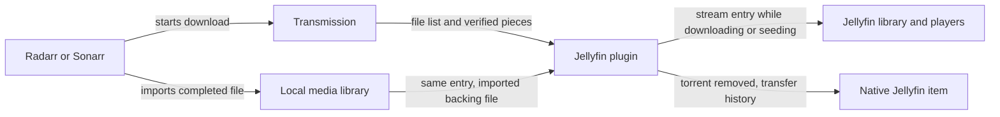

# Design and playback flow

The plugin gives an incomplete torrent a Jellyfin library entry. Its small stream link stays in place while the media moves into the final arr library and Transmission keeps
seeding. After torrent removal, the normal Jellyfin item takes over with each viewer's saved history. Transmission owns downloading and seeding; Jellyfin owns playback.

## Configuration initialization

Startup fills only missing local settings: a projection folder beneath the plugin's data directory and, where possible, a shared media root inferred from existing Movies and Shows
library paths. It ignores invalid or relative paths and its own projection folders, and rejects a filesystem root as too broad. Unclear media roots stay empty. Saved nonblank
settings retain ownership, and discovery stays disabled until the administrator enables it. An optional prefill failure must not block server startup.

The settings page can request fresh local suggestions through an administrator-only, read-only endpoint after libraries change. It also suggests the connected Jellyfin address for
a blank public URL, retaining a reverse-proxy base path without credentials, query strings, or fragments. These page suggestions are saved only on **Save**. External-service
addresses and secrets remain explicit configuration.

Per-service buttons read remote directories through the configured APIs, then propose editable translations into Jellyfin's filesystem. Discovery is read-only; the administrator
saves the reviewed mappings. Each service has an independent namespace, with the old shared-root pair retained as a fallback. See [configuration](configuration.md#connections-and-service-paths)
for examples and checks.

The plugin keeps Jellyfin's XML configuration as its persisted source. A host adapter configures standard .NET options and translates configuration-save events into change
tokens. Handlers read the current monitored options, while a previously obtained snapshot retains its own mapping values. Core and Logic do not depend on Jellyfin
packages or configuration APIs.

## Discovery

The plugin polls Transmission and matches each playable file to a configured arr queue entry by torrent hash. A movie download uses its primary video file. Standard single-episode
filenames identify episodes within a season pack. Unmanaged downloads, samples, and ambiguous identities are skipped.

Discovery creates a stable stream link and metadata sidecars beneath a dedicated projection folder. Jellyfin scans these as ordinary movies and episodes. Persisted state keeps
the entry's identity, capability secret, original torrent file, and eventual imported path together across restarts.

## Progressive playback

While a projection is managed, pressing Play opens its stable stream URL. The reader checks Transmission's verified piece map before reading each byte range from the shared filesystem. An allocated file may
already have its final length while much of its content is still missing, so file length alone never proves that a range is playable.

The reader sends available bytes and waits for missing pieces. It does not substitute zeros for missing data. By default, starting playback enables sequential downloading for that
torrent and moves its sequential cursor toward missing playback pieces. See [write-cache safety](configuration.md#sequential-downloading-and-write-cache-safety) for the disk-read requirement.

Cancellation stops the copy and releases its reader lease. A continuous stall has a deadline; if playback has already sent bytes, the connection is aborted instead of appending an
error document to the video. HEAD requests report length without starting a torrent read.

## Completion

After arr imports the download, the plugin checks the import history against the torrent hash, original filename, byte size, and imported file identity. A matching title or an
older library copy is insufficient proof. Once the exact import is confirmed, the same stream URL reads the imported local file, including after Transmission removes the torrent.

While the torrent remains in Transmission, the projection owns playback and history. Once the torrent disappears, the plugin revalidates the imported file and lets Jellyfin index it
normally. Active readers or playback defer retirement. It transfers every user's state, removes only its generated link/metadata and projected database entry, then archives a small
completion record. A failed step leaves durable state for retry. The native item then plays without the plugin. See [operations](operations.md) for merge and rollback details.

Indexing scans the physical folder that contains the import. A virtual collection can combine several folders without scanning their contents itself. If an initially empty folder
has no indexed root yet, a shallow root refresh registers it before the targeted scan; other libraries are not scanned recursively.

## Application boundaries

The domain defines media identities, playback state, and external-service contracts. Application requests coordinate discovery, authorization, streaming, and completion through
source-generated Mediator handlers. Root inference, service-mapping precedence, verified-piece gating, prioritization, and stall deadlines belong to application policy.
Infrastructure supplies HTTP clients, physical path confinement, offset reads, and SQLite persistence. Copying reads through a filesystem contract so the application tests its
waiting and cancellation rules without disk access. The plugin composes these layers
and adapts them to Jellyfin's configuration, HTTP endpoints, indexing, and user metadata.

Each layer uses feature folders and a root Bootstrapper. Logic owns its generated Mediator and handler registration; Plugin composes the Logic and Infrastructure roots with its
host adapters. Feature bootstrappers group explicit registrations where needed. Logic handlers are discovered without per-feature registration. Service implementations remain internal behind Core contracts. Jellyfin's public entry points
are the framework-required exceptions. The installed plugin needs no separate server, torrent engine, or database service.

Playback commands carry media identity, output, range, and read options. Each copy creates data-only session state for its cached torrent metadata, timestamps, and imported path.
Handlers receive the client, store, filesystem, options, clock, and Mediator through DI. Runtime messages do not carry service instances, service factories, or callbacks.

The settings UI uses focused browser modules for draft configuration, folder mappings, activity, and contextual help. Jellyfin serves the embedded page, stylesheet, and modules
from the plugin; there is no separate frontend server or build pipeline. Each page instance owns its draft and polling lifecycle. Tooltips explain the controls, and faint dashed
underlines mark explanatory text with help. Buttons keep their normal cursor and plain text. Hover or keyboard focus shows help after 150 ms; leaving the control, scrolling, or interacting dismisses it. Responsive layout uses the same field and action-button heights throughout.

The Jellyfin adapter also appends an owned activity-link section to each projected description, retaining the synopsis and unrelated links. Reconciliation replaces only that
section when the public server address changes and avoids duplicate links on subsequent polls. The link uses the configured public origin and reverse-proxy base path to reach
the existing administrator activity page, so it also works from another device.

## Cancelled downloads

A missing torrent can mean that arr is still importing it, so download disappearance alone does not revoke its permanent entry. Discovery first attempts the normal import handoff.
When no torrent and no existing imported backing file remain, cleanup checks the owning arr service's movie or series library. Only a successful, valid collection response proving
that the title is absent permits removal. A disabled or unconfigured connection, authentication error, outage, or malformed response retains the entry. Matching provider identifiers
also retain an entry if arr has re-added the same title with another internal ID.

Open stream readers or a Jellyfin playback session defer cleanup. Once removal is allowed, the host entry is removed without deleting media, followed by only the plugin-owned
stream link, its metadata sidecar, and temporary versions of those files. Physical path and ownership checks keep cleanup inside the dedicated projection root. Shared series
metadata and unrelated files remain. The tracking record is removed last, allowing partial failures to retry. Subsequent polls and restarts cannot recreate a removed entry, and
its old playback capability returns not found.

## Resource use

The plugin reads shared files and calls the Transmission, Radarr, and Sonarr APIs. It does not contact torrent peers or download a second media copy. Existing VPN isolation and
seeding rules remain with Transmission.

Each active copy rents a 128 KiB buffer, plus runtime, request, and metadata overhead. Readers check availability about every half second. Discovery defaults to every 10 seconds
and can be configured from 2 to 300 seconds. Import checks follow the polling cadence rather than running for every output chunk.

## Prototype limits

- Only downloads owned by a configured Radarr or Sonarr queue are discovered. Manually added torrents without an arr identity are skipped.
- Standard single-episode `S01E02` and `1x02` filenames are supported. Ambiguous multi-episode files and absolute-numbered anime names are not resolved.
- Transmission has one sequential cursor per torrent. Viewers at different positions can compete, so seeking is best effort.
- There is one stable projection per movie or episode. A later upgrade does not take it over automatically.
- Import matching rejects ambiguous history, different file sizes, and unrelated older releases.
- Native handoff needs the imported folder in a normal Jellyfin library. Until indexing succeeds and playback is idle, the projection remains managed.
- Jellyfin gives the native path its own item ID. Saved watch data is transferred, but old projection bookmarks and playback URLs stop working after retirement.

[Back to README](../README.md)
