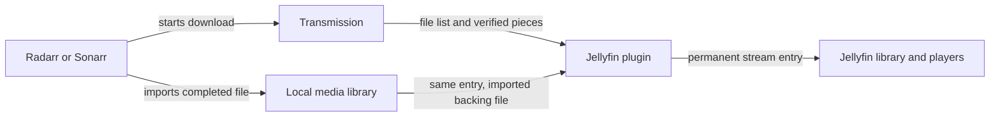

# Design and playback flow

The plugin gives an incomplete torrent a permanent Jellyfin library entry. Its small stream link stays in place while the media moves from an incomplete download to the final
arr library. Transmission owns downloading and seeding; Jellyfin owns playback and each viewer's history.

## Discovery

The plugin polls Transmission and matches each playable file to a configured arr queue entry by torrent hash. A movie download uses its primary video file. Standard single-episode
filenames identify episodes within a season pack. Unmanaged downloads, samples, and ambiguous identities are skipped.

Discovery creates a permanent stream link and metadata sidecars beneath a dedicated projection folder. Jellyfin scans these as ordinary movies and episodes. Persisted state keeps
the entry's identity, capability secret, original torrent file, and eventual imported path together across restarts.

## Progressive playback

Pressing Play opens the permanent stream URL. The reader checks Transmission's verified piece map before reading each byte range from the shared filesystem. An allocated file may
already have its final length while much of its content is still missing, so file length alone never proves that a range is playable.

The reader sends available bytes and waits for missing pieces. It does not substitute zeros for missing data. By default, starting playback enables sequential downloading for that
torrent and moves its sequential cursor toward missing playback pieces. See [write-cache safety](configuration.md#sequential-downloading-and-write-cache-safety) for the disk-read requirement.

Cancellation stops the copy and releases its reader lease. A continuous stall has a deadline; if playback has already sent bytes, the connection is aborted instead of appending an
error document to the video. HEAD requests report length without starting a torrent read.

## Completion

After arr imports the download, the plugin checks the import history against the torrent hash, original filename, byte size, and imported file identity. A matching title or an
older library copy is insufficient proof. Once the exact import is confirmed, the same stream URL reads the imported local file, including after Transmission removes the torrent.

The permanent Jellyfin entry remains the owner of watch history. Native duplicate detection and rollback are described in [operations](operations.md).

## Application boundaries

The domain defines media identities, playback state, and external-service contracts. Application requests coordinate discovery, authorization, streaming, and completion through
source-generated Mediator handlers. Infrastructure supplies HTTP clients, confined path mapping, piece-gated file reads, and SQLite persistence. The plugin composes these layers
and adapts them to Jellyfin's configuration, HTTP endpoints, indexing, and user metadata.

Each layer uses feature folders and composes feature bootstrappers through dependency injection. Service implementations remain internal behind their interfaces. Jellyfin's public
entry points are the framework-required exceptions. The installed plugin needs no separate server, torrent engine, or database service.

## Resource use

The plugin reads shared files and calls the Transmission, Radarr, and Sonarr APIs. It does not contact torrent peers or download a second media copy. Existing VPN isolation and
seeding rules remain with Transmission.

Each active copy rents a 128 KiB buffer, plus runtime, request, and metadata overhead. Readers check availability about every half second. Discovery defaults to every 10 seconds
and can be configured from 2 to 300 seconds. Import checks follow the polling cadence rather than running for every output chunk.

## Prototype limits

- Only downloads owned by a configured Radarr or Sonarr queue are discovered. Manually added torrents without an arr identity are skipped.
- Standard single-episode `S01E02` and `1x02` filenames are supported. Ambiguous multi-episode files and absolute-numbered anime names are not resolved.
- Transmission has one sequential cursor per torrent. Viewers at different positions can compete, so seeking is best effort.
- There is one stable projection per movie or episode. A later upgrade does not take it over automatically.
- Import matching rejects ambiguous history, different file sizes, and unrelated older releases.
- Permanent stream links continue to route through the plugin after completion. Removing it requires a library migration or restoring a backup.

[Back to README](../README.md)
