# Installation, development, and releases

There are two installation flows. Development builds load directly into a selected local Jellyfin plugin directory. Published releases install through Jellyfin's normal plugin
repository and Catalog.

## Local development

Install the .NET 10 SDK and clone the repository. Stop the development Jellyfin server, then run from the checkout:

```sh
dotnet run --file scripts/Install.cs -- --plugins-dir "/path/to/jellyfin/plugins"
```

The command builds Debug and copies the plugin's declared assemblies and generated metadata into a versioned directory beneath the chosen root. Add `--configuration Release`
after the CLI separator for a Release build.
It does not control the Jellyfin service. Make the resulting files readable by its service account, then start or restart Jellyfin to load them.

The destination name comes from plugin metadata. Development builds use `Transmission Streaming_0.0.0.0`; published packages use the tag-derived version in the same format.
If you previously installed the same plugin manually under another folder name, keep only one installation of that version before restarting.

After restart, open **Dashboard → Plugins → Transmission Streaming** in the left sidebar to configure the plugin.

Typical plugin roots are `/var/lib/jellyfin/plugins/` for native Linux and `/config/plugins/` inside the Jellyfin container. Choose the path belonging to the server you intend to
load; a path on the development machine does not automatically reach a remote server.

## Build a ZIP

Run:

```sh
dotnet run --file scripts/Package.cs
```

This builds the Release plugin and creates `artifacts/TransmissionStreaming_<version>.zip`. The package contains only the assemblies declared in plugin metadata and `meta.json`,
all at the ZIP root. Build output paths come from MSBuild, so the packaging process follows the selected target framework automatically.

For a direct manual installation, stop Jellyfin, create the metadata-derived version directory under its plugin root, and extract the ZIP there. Ensure the service account can
read it, then restart Jellyfin. Do not copy the whole build output or replace Jellyfin's own assemblies.

## CI artifacts

Pushes to `main`, pull requests targeting `main`, and manual runs on `main` build and run every test suite, including the disposable Transmission and Jellyfin tests. A successful
build uploads the plugin ZIP as a workflow artifact with 90-day retention. Open the completed run under GitHub Actions and download that artifact for manual installation. GitHub
requires sign-in for workflow-artifact downloads.

The artifact is already the plugin ZIP; it is uploaded without another wrapping archive. Normal users should use the published repository installation below.

## Published release and repository flow

```mermaid
flowchart LR
    P[Push main] --> C[Build and all tests]
    C --> A[Retain both tested plugin ZIPs]
    A --> D[Run the same workflow in release mode]
    D --> V[Verify selected build run and exact commit]
    V --> Z[Repack both tested ZIPs]
    Z --> R[Summary links to prepared draft]
    R --> U[Review and publish as Latest]
    U --> J[Jellyfin Catalog install]
```



1. Push the release commit to `main` and wait for passing CI.
2. Open that build's summary and copy its **Build run ID**. The summary also links to release preparation in the same workflow.
3. Choose **Actions → Build, test, and package → Run workflow**, with the workflow on `main` and **mode: release**.
4. Paste the successful build run ID. Choose `patch`, `minor`, or `major` to increment the highest published stable version, or `custom` with a `vMAJOR.MINOR.PATCH` tag.
5. Run the workflow. Its build job is skipped; **Prepare draft release** verifies and downloads the selected run's artifacts and checks out that run's exact commit.
6. Follow **Review and publish the prepared release** in the finished summary. Review the notes and all three assets, then **Publish release** as Latest.

GitHub shows input dropdowns when starting a workflow. Preparation therefore has its own run in the same workflow, with a link back to the source build. It does not append a
manual job to an already completed build. No environment approval gates or duplicate version jobs are needed.

Both plugins receive the same version. For example, `v1.2.3` produces `TransmissionStreaming_1.2.3.0.zip`, `HDRPlayback_1.2.3.0.zip`, and `manifest.json`. No source-version edit
or post-release bump is needed. See [versioning](versioning.md) for development versions and stable assembly identity. Pushing a tag alone does not create or publish a release.

Preparation accepts only a completed, successful `main` push run from this build workflow. Pull-request, failed, and release-preparation runs cannot substitute for it. The
job reuses both retained bundles without recompiling plugin DLLs or rerunning tests; missing or expired artifacts cause an error. It never falls back to rebuilding a
different bundle.

The repository manifest contains both plugin identities, their versions and target Jellyfin ABI, tag-specific ZIP URLs, and MD5 checksums of the final ZIP bytes. MD5 is the
checksum Jellyfin's repository protocol requires. The newest published catalog asset is merged so older versions remain available, even if a newer release has no catalog yet.
An already published plugin version cannot be reused.

Preparation jobs run serially. Publish or discard a pending draft before preparing another release so the next draft includes its published catalog history. If an upload fails
and leaves an incomplete draft, remove that draft before rerunning preparation. The workflow does not publish drafts or change their notes or Latest status for you.

The stable repository address is:

```text
https://github.com/Heehaaw/jellyfin-plugins/releases/latest/download/manifest.json
```

The first published release with its catalog makes this URL available. Every subsequent release updates its contents while each version's ZIP URL remains tied to its own tag.

To install through Jellyfin:

1. Open **Dashboard → Plugins → Manage Repositories**.
2. Add a repository name and the stable manifest URL above.
3. Find **Transmission Streaming** in the Catalog and install a compatible version.
4. Restart Jellyfin and open the plugin settings.

Jellyfin reads the manifest, filters compatible versions, downloads the ZIP, checks its MD5, and extracts it into the version directory. It then requests a restart. The target ABI
identifies the host API the package was built against; client playback still needs validation with the intended setup.

For a manually hosted release, the packaging command also accepts `--source-url` with the final HTTPS ZIP address, ending in `.zip`. It writes `artifacts/manifest.json` alongside
the ZIP. Supply `--previous-manifest-url` to retain an existing repository's versions. Publish the exact ZIP and manifest together; the default packaging command creates no catalog
entry for an unpublished artifact.

See the [official Jellyfin plugin guide](https://jellyfin.org/docs/general/server/plugins/) for its Catalog and manual-install workflow.

[Back to README](../README.md)
